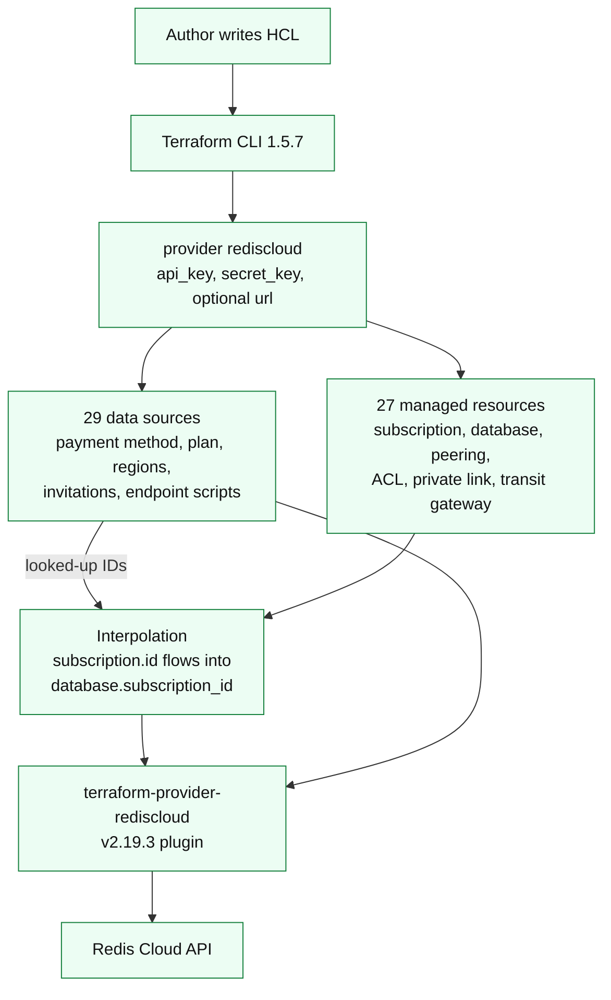
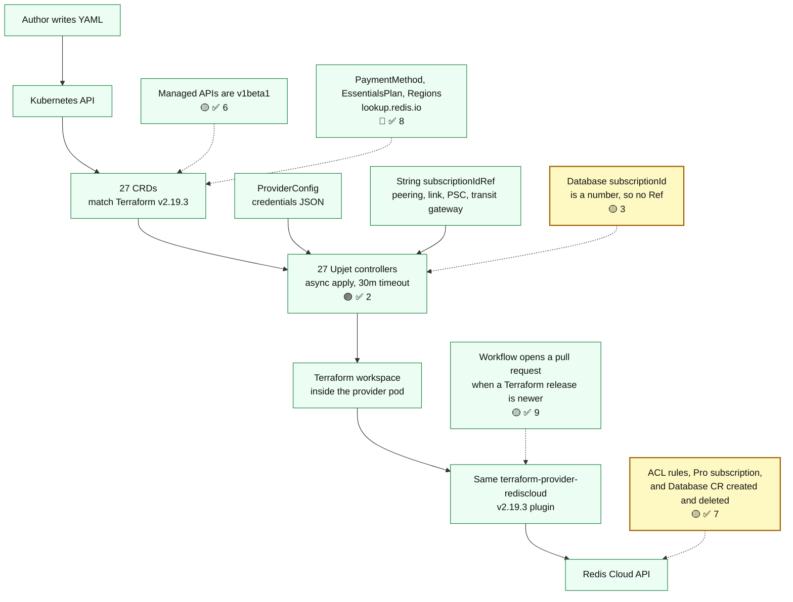

# Alignment with Terraform Provider v2.19.3

Current main: `a2b716c`.
Terraform provider pin: `RedisLabs/terraform-provider-rediscloud` v2.19.3. That is the newest release, published 28 October 2026.
Crossplane generator: Upjet v2.5.1. `config/schema.json` on this commit matches `terraform providers schema -json` from Terraform CLI 1.5.7 for v2.19.3.

This document tracks the alignment between this Crossplane provider and the official Redis Cloud Terraform provider. Parity is current through v2.19.3. A recount on 31 October 2026 found 27 managed resources and 29 data sources. Top-level resource fields are on the generated CRDs. Sensitive values are Kubernetes secret references. The Terraform `timeouts` block is provider meta and is not a CRD field. v2.19.3 added no managed resource and no managed field. On the `rediscloud_subscription` and `rediscloud_active_active_subscription` data sources, `maintenance_windows` and `pricing` are attributes rather than blocks, and `cloud_provider` is an attribute on the Pro subscription data source. Those data sources stay pasted IDs.

The original comparison, dated 21 October 2026, used branch `spike/tf-2.19.2-generate`, Terraform provider v2.19.2, and Upjet v1.4.1. Numbering and the architecture diagrams were added on 22 October 2026. Evidence dates for that comparison remain 21 October 2026. GitHub main at `6128cb7` in the tables below is that earlier main, before the alignment merge. Gaps 3, 4, and 8 stay as written. Gaps are numbered in one sequence from 1 through 9.

## Index

### Sections

- [Architectures](#architectures)
- [Result](#result)
- [Resource map](#resource-map)
- [Data sources](#data-sources)
- [What was run](#what-was-run)
- [What main already includes](#what-main-already-includes)
- [What not to treat as a gap](#what-not-to-treat-as-a-gap)
- [What was checked for a public repository](#what-was-checked-for-a-public-repository)

### Gaps

**severity:** 🔴 is high, 🟡 is medium, and 🟣 is minor. The index has two columns, Gap and Status. **Fix status:** is ✅, partial, or open. A fix explanation is labeled **Fix detail:**. **Left unfixed:** and **Plan:** are their own bullets. A plan starts with **Fix:** or **No fix**.

| Gap | Status |
| --- | --- |
| 1. Hand-written examples do not match the CRDs **severity:** 🟣 **Fix status:** ✅ | ✅ Fixed • **Fix detail:** The checker rejects unknown `forProvider` fields. 13 of 13 examples pass. |
| 2. Controller deadline is 3 minutes **severity:** 🟣 **Fix status:** ✅ | ✅ Fixed • **Fix detail:** Reconciler timeout raised from 3m to 30m across all 27 controllers after a live create was canceled at 180s. |
| 3. No cross-resource references **severity:** 🟡 **Fix status:** partial | Open for databases • **Fix detail:** String children have `subscriptionIdRef`. • **Left unfixed:** for databases because `subscription_id` is a number and Crossplane references only write strings. • **Plan:** No fix. Crossplane can write only a string into a reference, and the database subscription id is a number, so a database keeps copying `status.atProvider.id` by hand. That is not a planned code fix. |
| 4. Connection secret does not publish the endpoint **severity:** 🟡 **Fix status:** partial | ✅ Fixed for the endpoints the live secret contained • **Fix detail:** `databaseConnectionDetails` publishes `public_endpoint` and `private_endpoint`. The 27 October 2026 QA database secret had those two keys. `port` is an optional input in `config/schema.json`, not a computed attribute, so Terraform leaves it empty unless the manifest sets it. When Terraform state already contains `port`, that key is still published. Pro and Essentials endpoints are strings. An Active-Active endpoint is a region map, stored as `public_endpoint.<region>` and `private_endpoint.<region>`. A present `port` stays one number. • **Left unfixed:** for a provider-generated password because the sensitive-field mapping already owns that key. • **Plan:** No fix. The password already belongs to the sensitive-field mapping, so this provider will not write it a second time. |
| 5. One bad generated type **severity:** 🟡 **Fix status:** ✅ | ✅ Fixed • **Fix detail:** `initProvider.clientTlsCertificatesSecretRef` is a secret-reference list. |
| 6. Managed APIs are `v1alpha1` **severity:** 🟡 **Fix status:** fixed | ✅ Fixed • **Fix detail:** The 27 managed kinds are stored and reconciled as `v1beta1`. `v1alpha1` stays served for those same kinds so a cluster whose CRD `status.storedVersions` still lists `v1alpha1` can accept the package. Examples and the QA manifests use `v1beta1`. ProviderConfig stays `v1beta1`. PaymentMethod, EssentialsPlan, and Regions stay `lookup.redis.io/v1alpha1`. Generation keeps the `zz_*` files for both served versions. • **Plan:** No further change for this gap. Dropping served `v1alpha1` waits until those CRDs no longer record it as a stored version. |
| 7. No proof of a real apply **severity:** 🟡 **Fix status:** ✅ | ✅ Fixed • **Fix detail:** ACL rules, a Pro subscription, and a Database custom resource were created, became Ready, and were deleted against a Redis Cloud account. The database copied the numeric subscription id, reached Cloud active and Kubernetes Ready, then both were deleted cleanly. |
| 8. Data-source lookups are manual **severity:** 🔴 **Fix status:** partial | ✅ Fixed for payment method, Essentials plan, and region • **Fix detail:** `PaymentMethod`, `EssentialsPlan`, and `Regions` are read-only cluster objects in `lookup.redis.io`. They read the ProviderConfig credentials, call the Redis Cloud API, and write the matched id to status. Delete does not change the account. Examples are in `examples/lookup`. • **Left unfixed:** for the other 26 data sources. Callers keep pasting those IDs. • **Plan:** No fix for the other 26 data sources. Callers keep pasting those IDs. |
| 9. Stay aligned with later Terraform provider releases **severity:** 🟡 **Fix status:** ✅ | ✅ Fixed • **Fix detail:** `.github/workflows/terraform-release.yaml` opens a pull request when `RedisLabs/terraform-provider-rediscloud` publishes a release newer than `TERRAFORM_PROVIDER_VERSION`. That pull request changes the pin and regenerates. It does not merge itself, and it does not bump Crossplane, Go, or Upjet. |

## Architectures

The first diagram is Terraform provider v2.19.3, which is the baseline this provider is aligned against. The second is this Crossplane provider. Red boxes are 🔴 high. Yellow boxes are 🟡 medium. Green boxes are the path already on main. Gap labels use the same circles, with no red X.

### Terraform provider v2.19.3

A released Terraform provider already looks up IDs through data sources and passes a subscription id into a database. Payment method, plan, and region lookups are 🔴 ✅ [8](#g8). The database subscription id stays 🟡 [3](#g3) because that field is a number.

### Crossplane provider on main

The provider pod does not call Redis Cloud itself for managed resources. It runs Terraform, and Terraform runs the same plugin as the diagram above. The resource boxes match. Payment method, Essentials plan, and region lookups are read-only objects (🔴 ✅ [8](#g8)). The other data-source IDs stay pasted. 🟡 [3](#g3) stays yellow because string children already reference a subscription, and databases still cannot.

## Result

On main `a2b716c`, managed-resource coverage matches Terraform provider v2.19.3.

| Surface | Terraform v2.19.3 | Main `a2b716c` | Main before alignment (`6128cb7`) |
| --- | --- | --- | --- |
| Managed resources | 27 | 27, all generated | 21, schema frozen at Terraform v2.1.5 |
| Data sources | 29 | 3 read-only lookup CRDs; the other 26 stay pasted IDs | 0 CRDs |
| Provider settings | `api_key`, `secret_key`, `url` | `ProviderConfig` | `ProviderConfig` |

The `6128cb7` column is GitHub main before the alignment merge. Current main is `a2b716c`, and `TERRAFORM_PROVIDER_VERSION` is v2.19.3.

No managed resource from Terraform v2.19.3 is missing on main. Nothing extra was generated. A recount on 31 October 2026 compared the published v2.19.3 schema with the generated CRDs, and that count held. The numbered gaps run from 1 through 9. **severity:** 🔴 is high, 🟡 is medium, and 🟣 is minor. ✅ on **Status:** means this provider fixed that gap.

## Resource map

All 27 Terraform resources have a generated kind, CRD, and controller on main `a2b716c`. The `On 6128cb7` column is GitHub main before the alignment merge: ✅ means the resource was already there and ❌ means it was not. Six were ❌. The `On main a2b716c` column is the current provider, and every row there is ✅.

| Terraform resource | Kind | API group | On `6128cb7` | On main `a2b716c` |
| --- | --- | --- | --- | --- |
| `rediscloud_acl_role` | Role | `acl.redis.io` | ✅ | ✅ |
| `rediscloud_acl_rule` | Rule | `acl.redis.io` | ✅ | ✅ |
| `rediscloud_acl_user` | User | `acl.redis.io` | ✅ | ✅ |
| `rediscloud_active_active_private_link` | ActivePrivateLink | `active.redis.io` | ❌ | ✅ |
| `rediscloud_active_active_private_service_connect` | ActivePrivateServiceConnect | `active.redis.io` | ✅ | ✅ |
| `rediscloud_active_active_private_service_connect_endpoint` | ActivePrivateServiceConnectEndpoint | `active.redis.io` | ✅ | ✅ |
| `rediscloud_active_active_private_service_connect_endpoint_accepter` | ActivePrivateServiceConnectEndpointAccepter | `active.redis.io` | ✅ | ✅ |
| `rediscloud_active_active_subscription` | ActiveSubscription | `active.redis.io` | ✅ | ✅ |
| `rediscloud_active_active_subscription_database` | ActiveSubscriptionDatabase | `active.redis.io` | ✅ | ✅ |
| `rediscloud_active_active_subscription_peering` | ActiveSubscriptionPeering | `active.redis.io` | ✅ | ✅ |
| `rediscloud_active_active_subscription_regions` | ActiveSubscriptionRegions | `active.redis.io` | ✅ | ✅ |
| `rediscloud_active_active_transit_gateway_attachment` | ActiveTransitGatewayAttachment | `active.redis.io` | ✅ | ✅ |
| `rediscloud_active_active_transit_gateway_invitation_acceptor` | ActiveTransitGatewayInvitationAcceptor | `active.redis.io` | ❌ | ✅ |
| `rediscloud_active_active_transit_gateway_route` | ActiveTransitGatewayRoute | `active.redis.io` | ❌ | ✅ |
| `rediscloud_cloud_account` | Account | `cloud.redis.io` | ✅ | ✅ |
| `rediscloud_essentials_database` | Database | `essentials.redis.io` | ✅ | ✅ |
| `rediscloud_essentials_subscription` | Subscription | `essentials.redis.io` | ✅ | ✅ |
| `rediscloud_private_link` | Link | `private.redis.io` | ❌ | ✅ |
| `rediscloud_private_service_connect` | ServiceConnect | `private.redis.io` | ✅ | ✅ |
| `rediscloud_private_service_connect_endpoint` | ServiceConnectEndpoint | `private.redis.io` | ✅ | ✅ |
| `rediscloud_private_service_connect_endpoint_accepter` | ServiceConnectEndpointAccepter | `private.redis.io` | ✅ | ✅ |
| `rediscloud_subscription` | Subscription | `rediscloud.redis.io` | ✅ | ✅ |
| `rediscloud_subscription_database` | Database | `subscription.redis.io` | ✅ | ✅ |
| `rediscloud_subscription_peering` | Peering | `subscription.redis.io` | ✅ | ✅ |
| `rediscloud_transit_gateway_attachment` | GatewayAttachment | `transit.redis.io` | ✅ | ✅ |
| `rediscloud_transit_gateway_invitation_acceptor` | GatewayInvitationAcceptor | `transit.redis.io` | ❌ | ✅ |
| `rediscloud_transit_gateway_route` | GatewayRoute | `transit.redis.io` | ❌ | ✅ |

`rediscloud_cloud_account` and `rediscloud_active_active_subscription_database` are Terraform Plugin Framework resources. Both generated.

Top-level Terraform attributes and blocks were compared with the generated `tf:` tags. The only names absent as plain attributes are sensitive values. Those are present as Kubernetes secret references, which is the Crossplane form of the same field:

| Terraform field | Crossplane field |
| --- | --- |
| database `password` | `passwordSecretRef` |
| Active-Active `global_password` | `globalPasswordSecretRef` |
| Active-Active `client_ssl_certificate` | `clientSslCertificateSecretRef` |
| Active-Active `client_tls_certificates` | `clientTlsCertificatesSecretRef` |
| ACL user `password` | secret reference on the user |
| cloud account `access_secret_key` | `accessSecretKeySecretRef` |
| cloud account `console_password` | `consolePasswordSecretRef` |

Resources that already existed on GitHub `main` were regenerated from v2.19.2, so fields added after v2.1.5 are on the CRDs. On the generated types, Pro subscription has `resourceTags`, `prometheusEndpoint`, and customer-managed key fields. Active-Active database has `redisVersion`, `redisVersionActual`, `autoMinorVersionUpgrade`, and `globalEnablePasswordless`. Pro database has `enablePasswordless` for Terraform `enable_passwordless`. See `docs/design/RED-223310.md`.

## Data sources

Terraform data sources are read-only lookups. Upjet does not turn them into managed resources. That is expected. There are 29 data sources in v2.19.3, the same count as v2.19.2. The ones a user cannot proceed without, because the CRD wants an ID the data source would have looked up, are:

| Data source | Why it matters |
| --- | --- |
| `rediscloud_payment_method` | Pro and Essentials subscriptions take `paymentMethodId`. |
| `rediscloud_essentials_plan` | Essentials subscription needs a plan. |
| `rediscloud_regions` | Region selection for subscriptions. |
| `rediscloud_data_persistence` | Persistence option lookup. |
| `rediscloud_database`, `rediscloud_database_modules` | Lookup of an existing database. |
| `rediscloud_transit_gateway_invitations`, `rediscloud_active_active_transit_gateway_invitations` | Input to the invitation-acceptor resources. |
| `rediscloud_private_link_endpoint_script`, `rediscloud_active_active_private_link_endpoint_script` | Generated endpoint scripts. No managed resource creates these. |

`PaymentMethod`, `EssentialsPlan`, and `Regions` in `lookup.redis.io` perform the first three lookups. A user still pastes IDs for the other data sources. There is no Crossplane reference from a numeric field, so an Essentials plan id and a database subscription id are copied from status by hand. Child resources whose `subscription_id` is a string now have `subscriptionIdRef`. `subscriptionId` on a Pro database is a number (`*float64` in `apis/subscription/v1beta1/zz_database_types.go`), so that field has no reference. Terraform HCL can interpolate `${rediscloud_subscription.example.id}`. This provider cannot, for databases. That is a composition gap, not a missing resource.

## What was run

| Check | Result |
| --- | --- |
| `terraform providers schema -json` for v2.19.2 | Succeeded during `make generate`. 27 resources, 29 data sources. |
| Recount on main `a2b716c`, 31 October 2026 | Terraform CLI 1.5.7 `providers schema -json` for v2.19.3 matches `config/schema.json`. 27 managed resources, 29 data sources. Top-level managed fields are on the `v1beta1` CRDs. Sensitive fields are secret references. v2.19.3 is the newest release. |
| `make generate` with Go 1.24.11 | Succeeded. `Generated 27 resources!` |
| `go test ./config/... ./cmd/... ./apis/... ./internal/...` | Passed on 21 October 2026. The only test files then were in `config`. |
| Alignment guard tests, 28 October 2026 | Passed locally. The Go test requires the 30 minute controller timeout, the Active-Active TLS secret-reference list, and no `subscriptionIdRef` on database types. The Python test rejects an unknown `forProvider` field and accepts the example again after that field is removed. |
| `go test ./internal/lookup/ ./internal/controller/lookup/` | Passed on 23 October 2026. Filter tests and a payment-method reconcile test against a local HTTP server. |
| Lookup objects on the test cluster | `PaymentMethod`, `EssentialsPlan`, and `Regions` became Ready. Status ids matched the Redis Cloud API for the same filters. Deleting the objects left the account payment methods unchanged. |
| `go build -buildvcs=false -o /tmp/provider-rediscloud-spike ./cmd/provider` | Passed. |
| `python3 scripts/check-examples.py package/crds examples` | Passed. 16 examples, including the three lookups and the six resources added in Terraform v2.19.2. |
| Release-tracking dry run and fixture, 26 October 2026 | A dry run against published v2.19.2 opens nothing. Fixture tag `v2.20.0` opens a pull request that changes `TERRAFORM_PROVIDER_VERSION` and leaves `CROSSPLANE_VERSION` unchanged. A generate result that restores the 3 minute timeout does not open a pull request. |
| `golangci-lint` v1.64.8 on `./config/...`, `./internal/clients/...`, `./cmd/...` | Passed with `GOFLAGS=-buildvcs=false`. |
| ACL rule on a Redis Cloud account | Three create, Ready, and delete cycles. Each rule was verified deleted from the Cloud API after deletion. |
| Pro subscription on a Redis Cloud account | Three create, Ready, and delete cycles. Each reached Cloud `active` and Kubernetes Ready, then verified deleted (404). An additional subscription was created for Database CR verification and deleted the same way. |
| Database CR on a Pro subscription | `subscription.redis.io` Database `crossplane-db-1` copied numeric `subscriptionId` by hand. The database reached Cloud `active` and the CR reached Ready. Delete removed the database first (Cloud 404), then the subscription (Cloud 404). |

`scripts/test-provider.sh` was not used. It builds a new kind cluster with podman, and this test used an existing test cluster. `.envrc` still has placeholder keys. The credentials used for the live calls stayed outside the repository.

## What main already includes

- Terraform pin moved from v2.1.5 to v2.19.2.
- Main `a2b716c` pins `TERRAFORM_PROVIDER_VERSION` at v2.19.3. That release added no managed resource.
- The six resources added after v2.1.5 are generated.
- Fields added on existing resources through v2.19.2 are on the CRDs.
- Both Plugin Framework resources generate, and all 27 controllers are registered in `internal/controller/zz_setup.go`.
- The provider binary compiles.
- 🟣 ✅ [1](#g1). Hand-written examples match the CRDs, and the example checker now looks at `spec.forProvider`.
- 🟣 ✅ [2](#g2). Controller timeout increased from 3m to 30m across all 27 controllers in code generation.
- 🟡 [3](#g3), string children only. `subscription_id` fields reference the parent subscription. Databases still copy the id by hand.
- 🟡 ✅ [4](#g4). The live database secret contained `public_endpoint` and `private_endpoint`. A `port` already present in Terraform state is still published. Active-Active endpoints are stored per region.
- 🟡 ✅ [5](#g5). The Active-Active TLS `initProvider` field matches `forProvider`.
- 🟡 ✅ [7](#g7). ACL rules, a Pro subscription, and a Database CR were created, became Ready, and were deleted against a Redis Cloud account.
- 🔴 ✅ [8](#g8), three lookups only. `PaymentMethod`, `EssentialsPlan`, and `Regions` write the matched id to status. The other 26 data sources stay pasted IDs.
- 🟡 ✅ [9](#g9). A workflow opens a pull request when Terraform Redis Cloud publishes a release newer than `TERRAFORM_PROVIDER_VERSION`. The pull request changes that pin and regenerates. It does not merge, and it does not bump Crossplane, Go, or Upjet.
- Examples for the six resources added in Terraform v2.19.2 are in `examples/private`, `examples/transit`, and `examples/active`. `config/coverage_test.go` lists all 27 managed resources and those six.

## What not to treat as a gap

- Missing data-source CRDs, except where an install flow has no other way to learn an ID. The data-source table names those.
- Breaking changes in CRD schemas against unreleased historical snapshots (schema reflects Terraform v2.19.3).

## What was checked for a public repository

This repository is public. A search of the tree for key material and private-key headers found none. `.envrc` still contains the placeholder `your-api-key-here`.
